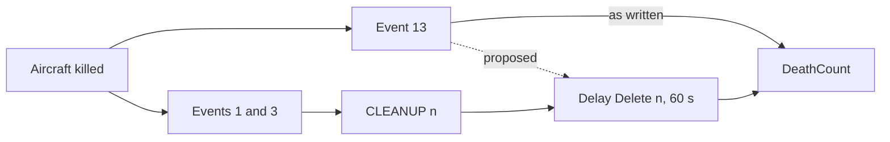
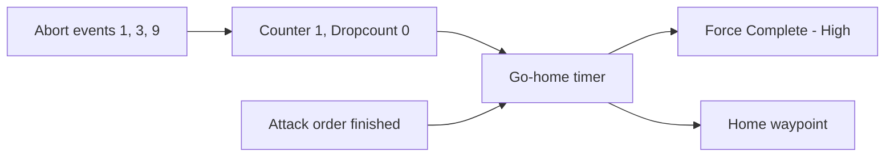

# Issue for `eszyman/IL2MissionUtility` (posted)

> Status: draft, updated 2026-10-14 after flight 1P (the plan's "flight 1N"), which confirmed section 3's fix. `/hfe-mayer` pass done 2026-10-14. **Posted 2026-10-14 with the user's go-ahead: https://github.com/eszyman/IL2MissionUtility/issues/1** (from gh account `GhengisPliskinAutomata`). This file is the posted text; follow-ups go on the issue.

---

**Title:** Korea 1.005: jet strikes and CAPs abort on start, the death counter never counts aircraft, and the clean-up Delete removes nothing

Hi. I use the fork at `Pliskin-Industries/Claude-IL2MissionUtility`. While building a new tab I flew a series of small test missions with the game's text log switched on, to check what the generated logic really does in IL-2 Korea. Each result below is from a logged flight, not from reading the code; the logs and the mission files are in the fork and I can attach whatever helps.

Game version 1.005 (`261013`), dogfight server hosted from the client, AI aircraft only.

In short, I found three problems, and each fix below has been flown and works:

1. **Repeat spawns never repeat for aircraft.** A unit's entity can send a pulse to another MCU when something happens to it; the `OnEvent` `Type` number says what. Event 4 is `OnPlaneDestroyed`, offered for aircraft only. Event 13 is `OnKilled`, which every unit has, aircraft included. The app's death counter listens for event 4 on aircraft, and the game never raises it: a dead aircraft raises 13. Switching aircraft to 13 fixes it. Fighter Pack needs one more change with it, or every kill counts twice.
2. **Finished groups are never deleted.** `Trigger Delete` names the units' own blocks, which the game ignores; it needs their entities. In Activate mode the Delete should not be written at all, because the group must come back.
3. **Jet strikes and CAPs go home as soon as they start, and the Il-10 strike never gets home.** The jets raise event 7 (bingo fuel) seconds after activation, and the files treat it as "go home". Separately, when the go-home step fires more than once, the flight is left with no orders. Dropping event 7 as an abort, and letting the go-home step fire only once per flight, fixes both.

## 1. A destroyed aircraft raises event 13, never event 4

### What the app writes

For an aircraft, the death counter (`DeathCount`) listens for `OnPlaneDestroyed` (event type 4). That is `EntityEvent::default_for(UnitKind::Plane)`.

### What the game does

Every aircraft I destroyed raised `OnKilled` (13) once, at the moment it died. None raised 4. That held for a Damage command, AI gunfire, a mid-air collision, a crash during a fight, and an aircraft that ran out of fuel (13 fired when the pilot bailed out).

I generated a repeat-spawn group with the app's own `generate_template` ("Allow multiple spawns" on) and killed the first wave:

| Group | Death event | After the first wave was killed |
|---|---|---|
| as generated | 4 | `DeathCount` never fired. No second wave. |
| same group, event changed to 13 | 13 | `DeathCount` fired at once, `COOLDOWN` ran, the second wave spawned. Killing that wave started the cycle again. |

So with event 4 the next wave only comes if players leave the zone and return.

### Proposed fix

`EntityEvent::default_for` returns `OnKilled` (13) for aircraft as it already does for everything else. One line; each generated aircraft's `OnEvent` to `DeathCount` changes from `Type = 4` to `Type = 13`.

### Fighter Pack needs a second change with it

In a Fighter Pack flight each aircraft feeds its flight's `DeathCount` twice. A kill also raises pilot wounded (1) and critical damage (3), and Fighter Pack sends both to `CLEANUP n`:

So once the death event fires, every kill counts twice, and a 4-ship is replaced after two losses. Today the double feed does no harm only because event 4 never fires. With the proposed wiring the timer is each aircraft's only feed, and a timer that is triggered again while it runs restarts and fires once (measured on 1.004 and 1.005). The change is one `TarId` per aircraft and no new MCUs. I flew both:

| Fighter Pack flight, four F-80Cs killed at once | `DeathCount` fired |
|---|---|
| death event 13 on `DeathCount` | twice: at the kills, and 60 s later |
| death event 13 on that aircraft's own `Delay Delete n` | once, 60 s after the kills |

I can send the patch for both changes.

## 2. `Trigger Delete` lists the units' own indexes, and the game ignores it

### What the app writes

`Deactivate Units` lists each unit's entity (`MCU_TR_Entity`) index. `Trigger Delete` lists each unit's own block index (`object_ids` in `generate_template`).

### What the game does

I deleted two live aircraft two ways:

| `MCU_Delete` Objects | Result 30 s later |
|---|---|
| the two entity indexes (what the mission editor writes when you object-link a Delete) | both aircraft gone |
| the two Plane block indexes (what the app writes) | both aircraft still flying |

So a group that reaches `MISSION END` is deactivated but never deleted. It stays in the mission, switched off. With repeat spawns every finished wave stays: after one clean-up and one respawn, the log's end-of-mission list held two copies of each aircraft, the live one and the first one.

### A catch before fixing it

In Activate mode the group is re-activated when players come back to the zone. That works today only because the Delete does nothing. With entity indexes in `Trigger Delete`, my re-activated group did not come back. In Spawn mode the corrected Delete was fine: the next wave still spawned.

### Proposed fix

- Spawn mode: `Trigger Delete` lists the entity indexes (`entity_ids` in place of `object_ids`).
- Activate mode: do not write `DELETE DELAY` and `Trigger Delete` at all. The Deactivate already does the job, the units are needed again, and it saves two MCUs per group.

I can send the patch.

## 3. Strike and CAP: jets abort at once, and the go-home step can leave a flight with no orders

### What the app writes

I flew the strike and CAP groups your app writes (built at commit `a31ad0a` with Template Builder's own functions and the options the UI leaves), unchanged apart from added listeners. Every abort event, event 7 (bingo fuel) among them, pulses one go-home timer, which sends `Force Complete - High` and the home waypoint to the lead.

### What the game does

Two runs of each:

| Group | What happened, both runs |
|---|---|
| F-80C strike, as written | All four raised event 7 3 s after they were activated, with full tanks. The go-home timer fired at once. The flight never reached its AttackArea. |
| Same strike, event 7 hooks removed | Attacked, went home when out of bombs, `Mission Complete` at about 5:50. |
| F-86A CAP, as written | Event 7 at 3 s, went home at once. |
| Same CAP, event 7 hooks removed | Patrolled normally. |
| Il-10 strike, as written | No event 7. Attacked, then never got home: the go-home timer fired two or three times, and the flight stayed near the target with no orders. |

Event 7: the F-80Cs and F-86As in these files raise it about 3 s after activation; the Il-10s did not. It is not simply the type: twelve single aircraft as Template Builder writes them, the F-80C and F-86A among them, did not raise it, and nor did a Fighter Pack F-80C flight. Why the game raises it is not known.

The go-home timer: when the four "out of bombs" events arrived within half a second, the timer fired once and the flight went home. When they arrived over about a second, it fired twice. The second Force Complete seems to end the home waypoint the flight is already flying to, and the repeated waypoint does not restart it. A flight with no orders stays where it is, which is what the Il-10s did.

### Proposed fix

- Do not use event 7 as an abort for jets (or at all, until it is understood).
- Make the go-home step fire once per flight: a `Counter` of 1 that does not reset (`Counter = 1`, `Dropcount = 0`), between the abort events and the go-home timer. One MCU per flight.

### The fix, flown

One run:

| Group | What happened |
|---|---|
| Il-10 strike, as written (control) | the go-home timer fired four times; no `Mission Complete`; the survivors stayed near the target |
| Il-10 strike with the once-only counter | the go-home timer fired once; home; `Mission Complete` at 7:29 |
| F-80C strike, event 7 hooks removed, with the counter | went home when its attack order ran out (no target in its area); `Mission Complete` at 6:28 |

I also flew the Il-10 strike with the Force Complete removed from the go-home timer. It went home too, but its four abort events came within 0.3 s, so the timer fired once and the case that matters was not tested. The counter is the fix I would propose.

## 4. Smaller things, for information

- `AiRTBDecision = 1` can take aircraft out of the mission's hands. When a formation with that setting was damaged, all its aircraft but one stopped answering Delete, Deactivate and Damage commands, flew to the nearest friendly airfield and landed (one of two in four pairs, three of four in a 4-ship). With `AiRTBDecision = 0` every aircraft stayed on task and deleted cleanly. Your strike and CAP files already write 0; a Template Builder group whose aircraft carry 1 would be affected.
- A strike that is shot down never reaches `Mission Complete`, so nothing pulses `MISSION END`. When strikes share Exclusive Activation, that plan would hold the lock. I read this from the code and have not flown it.
- `MissionResaver.exe` crashes on every mission since 1.005, including the game's own `_test_dogfight_IL-3.Mission`. The game still hosts a plain `.Mission` with its `.eng`.

## How these were tested

Each test mission has a handful of AI flights well away from each other. A timer does one thing to each flight (kill it, delete it, start its own bring-up node), and 30 seconds later a "detector" tries to kill every aircraft in it: an aircraft that still exists dies and raises event 13, one that was removed stays silent. The end-of-mission list in the log gives a second, independent count of what still exists. Events are made visible by pointing each one at a `Mission Objective` MCU, which the text log records with its time.

## Why I was looking

The fork is adding a tab we call Air Tasking ("Wing Commander"). Its job is to run the AI air war from inside the utility: you mark areas and objectives on the Map, and the app writes the logic that launches historical sorties against them during the mission, from a mission clock and when players enter an area, within a budget of sorties alive per side. It builds on the groups Template Builder generates, which is how these three points surfaced. Your new strike and CAP missions are a natural base for it: Air Tasking could schedule and budget them instead of running them one at a time. If that interests you I would rather build it in a way you can take upstream.

I am happy to send the mission files, the logs, or patches for 1, 2 and 3.
